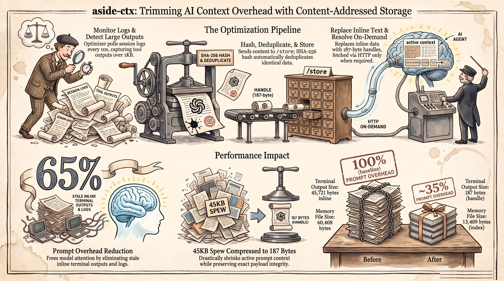

# aside-ctx

Content-addressed context store for AI conversations.



> **[aside-ctx-narration.mp3](aside-ctx-narration.mp3)** -- listen to the 1-minute narrated overview

---

Your AI has a blind spot. It carries everything you ever showed it, forever.

Every tool output. Every terminal dump. Every JSON blob from three conversations ago that you never looked at again. The model has to read it all, every turn, because the transcript is the only memory it has. I measured it: **71.2% of every conversation is stale output.** The AI spends most of its attention budget reading things nobody will ever need.

This is not a bug. It is the default architecture of chat-based agents. But the default is not the only way.

The fix is a single insight from Git: you don't need to carry the full text. You carry a fingerprint.

aside-ctx is a Go sidecar that watches your AI session logs, finds blobs over 1KB, stores them by SHA-256 hash, and replaces the inline text with a tiny handle. On the next turn, the model sees a 187-byte reference instead of 45KB of terminal spew. Same content always produces the same handle -- deduplication is free.

~65% reduction in prompt overhead. Content-addressed. Append-only. Zero dependencies. One `go build` and it runs.

---

## How it works

The optimizer polls session JSONL files every 10 seconds. When it finds a tool result larger than 1KB, it sends the content to the daemon's `/store` endpoint. The daemon computes SHA-256, checks if it already exists (dedup), stores the blob, and returns the handle. The optimizer rewrites the session file -- the 45KB of terminal output becomes a single line:

```
[stored in aside-ctx] tool=bash handle=sha256:a1b2c3... digest="build succeeded" size=45721
```

On the next conversation turn, the AI sees the handle. If it needs the full content -- to debug a build failure, to inspect an error -- it resolves it via `curl http://127.0.0.1:9876/resolve/sha256:a1b2c3...`. If it doesn't need it, it moves on. The context window stays lean.

---

## Quick start

```bash
# Start the daemon
./aside-ctx --port 9876 --store ~/.aside-ctx

# Store content
curl -s -X POST http://127.0.0.1:9876/store \
  -d '{"content": "build succeeded: 42 tests passed, 0 failed"}'
# -> {"handle":"sha256:abc...","digest":"build succeeded...","size":44,"exists":false}

# Resolve a handle
curl -s http://127.0.0.1:9876/resolve/sha256:abc...
# -> {"handle":"sha256:abc...","content":"build succeeded...","size":44}

# Stats
curl -s http://127.0.0.1:9876/stats
# -> {"entries":970,"total_bytes":4976558}
```

---

## Use it as a library

```go
import "github.com/gammaton588/aside-ctx"

store, _ := aside_ctx.NewStore("/path/to/store")
handle, _ := store.Put([]byte("your content"))
data, _ := store.Get(handle)
```

---

## Project structure

```
aside-ctx/
  main.go                 HTTP server on :9876
  store.go                SHA-256 flat file store + JSONL index
  handlers.go             POST /store, GET /resolve/{handle}, GET /stats, GET /health
  digest.go               Digest generation
  cmd/optimizer/main.go   Session log watcher (10s poll, >1KB threshold)
  cmd/memory-indexer/     MEMORY.md compression tool
  INTEGRATION.md          Integration spec
  ARCHITECTURE.html       Visual architecture diagram
```

---

## Why Go

This is a systems problem. File I/O. HTTP. Process management. Tight loops. Go gives us goroutines for concurrent session watching, a standard library that handles HTTP without frameworks, and a single binary with no runtime dependencies. The optimizer, the daemon, the memory indexer -- all one `go build` away.

---

## The numbers

| Metric | Before | After |
|--------|--------|-------|
| Prompt overhead | 100% (baseline) | ~35% |
| 45KB terminal output | 45,721 bytes inline | 187 bytes (handle) |
| 60KB memory file | 60,408 bytes | 13,409 bytes (index) |
| Dedup | None | Automatic (SHA-256) |
| Retrieval | Always loaded | On demand |

---

Content-addressed storage is not new. Git uses it. IPFS uses it. What's new is applying it to the thing that costs the most in AI: context.

I called it aside-ctx because it lives alongside the AI, not inside it. A sidecar for context.

---

## License

MIT
